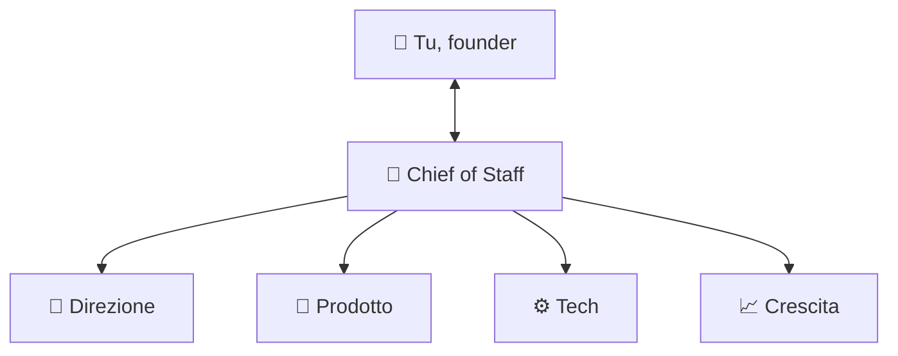

# 🏢 Agent Company Kit

**Un'intera azienda di agenti AI dentro Claude Code.** 16 specialisti divisi in 4 reparti, un Chief of Staff che li coordina e una memoria condivisa che non ti mangia i token.

Scrivi il tuo obiettivo → il team lo spezza in task, li assegna al reparto giusto e ti riporta solo quello che serve.

```
/kickoff                                  ← 5 minuti: il team impara la tua azienda
/goal lanciare la waitlist entro venerdì  ← il team pianifica ed esegue
/standup                                  ← ogni mattina: fatto, bloccato, prossimo
```

---

## 🚀 Inizia in 3 passi

Ti serve solo [Claude Code](https://claude.com/claude-code) installato.

**1. Scarica il kit** (progetto nuovo)
```bash
git clone https://github.com/Fabriics/agent-company-kit.git la-mia-azienda
```

**2. Apri Claude Code nella cartella**
```bash
cd la-mia-azienda && claude
```

**3. Scrivi `/kickoff`** e rispondi a 7 domande. Fine: il team è configurato.

<details>
<summary><b>Hai già un progetto?</b> Installa il kit lì dentro senza sovrascrivere nulla</summary>

```bash
git clone https://github.com/Fabriics/agent-company-kit.git ~/agent-company-kit
```
```bash
~/agent-company-kit/install.sh /percorso/del/tuo/progetto
```
Poi apri `claude` nel tuo progetto e scrivi `/kickoff`. Se hai già un `CLAUDE.md`, le regole del kit vengono aggiunte in fondo.
</details>

---

## 👥 Il team



| Reparto | Agenti | Cosa fanno per te |
|---|---|---|
| 🎯 **Direzione** | `ceo` · `finance` · `legal` | strategia e priorità, prezzi e runway, privacy e termini (in bozza) |
| 🧩 **Prodotto** | `product-manager` · `designer` · `researcher` | roadmap e user story, UX/UI e design system, mercato e competitor |
| ⚙️ **Tech** | `tech-lead` · `frontend` · `backend` · `devops` · `qa` · `security` | architettura, codice, deploy, test, sicurezza |
| 📈 **Crescita** | `marketing` · `sales` · `customer-success` · `data-analyst` | contenuti e lancio, lead e outreach, onboarding e supporto, metriche |

Il **Chief of Staff** è la tua sessione di Claude Code: ascolta te, decide chi deve lavorare e tiene aggiornata la board. Non devi ricordarti i nomi degli agenti: parla normalmente.

## 💬 Cosa puoi chiedere

- *"Analizza i 5 competitor principali e dimmi dove possiamo vincere"*
- *"Scrivi il PRD per la registrazione e falla implementare"*
- *"Prepara la landing con waitlist e il piano di lancio"*
- *"Quanto mi costa lo stack al mese e qual è il prezzo giusto?"*
- *"Fai un audit di sicurezza prima del lancio"*
- *"Scrivi privacy policy e cookie policy in bozza"*

## ⚡ Comandi

| Comando | Cosa fa | Quando |
|---|---|---|
| `/kickoff` | intervista guidata, configura profilo e squadra | una volta (o per aggiornare) |
| `/goal <obiettivo>` | piano → assegnazione → esecuzione coordinata | quando vuoi un risultato |
| `/standup` | fatto / in corso / bloccato / 3 cose da fare oggi | ogni mattina |
| `/tidy` | pulisce e compatta la memoria del team | una volta a settimana |
| `/stack-check` | verifica sul web tool, API e free tier per il tuo stack | all'inizio e ogni mese |

## 🪶 Pensato per spendere pochi token

- **Squadra per fase:** in fase "idea" sono attivi 6 agenti, non 16. Gli altri restano spenti e costano zero.
- **Memoria a livelli:** solo un file corto è sempre caricato; il resto si legge quando serve, l'archivio mai.
- **Brief e report corti:** gli agenti ricevono solo i fatti utili e rispondono in massimo 10 righe.
- **Modelli giusti:** Opus solo per strategia e sicurezza, Sonnet per il lavoro, Haiku per lo standup.
- **I comandi non costano finché non li usi**, e `/tidy` impedisce alla memoria di crescere all'infinito.

## 🗂️ Cosa c'è dentro

```
CLAUDE.md            il cervello: profilo azienda + regole del Chief of Staff
.claude/agents/      i 16 agenti
.claude/skills/      i 5 comandi
company/             la conoscenza dell'azienda: strategia, prodotto, design, tech, GTM, metriche, finanza, legale
team/                la memoria di lavoro: board, decisioni, lezioni apprese
docs/PLAYBOOK.md     cosa fa ogni reparto in ogni fase (idea → mvp → lancio → crescita)
docs/HOW-IT-WORKS.md architettura, memoria, token, personalizzazione
```

## 🛡️ Tu resti al comando

Gli agenti **preparano**, tu **approvi**: spese, invii di email e messaggi, pubblicazioni, deploy in produzione, azioni irreversibili e testi legali definitivi passano sempre da te. Gli agenti non possono leggere i tuoi file `.env`.

> ⚠️ Le bozze legali e finanziarie non sostituiscono un avvocato o un commercialista.

---

Vuoi capire come funziona sotto il cofano o aggiungere un tuo agente? Leggi [docs/HOW-IT-WORKS.md](docs/HOW-IT-WORKS.md).

Licenza [MIT](LICENSE): usalo, modificalo, condividilo. Se ti è utile, lascia una ⭐ e raccontami cosa stai costruendo.
