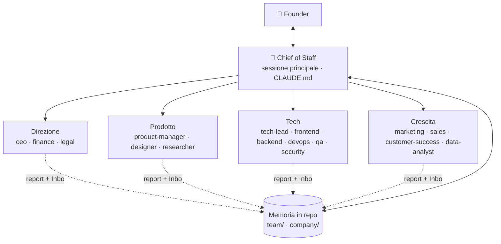

# Come funziona

> Per chi vuole capire o personalizzare il kit. Gli agenti non leggono questo file.

## 1. Architettura



- **Il Chief of Staff è la sessione principale**, non un agente separato. In Claude Code i subagent non possono lanciare altri subagent: l'unico punto da cui si coordina il team è la conversazione principale. Le sue regole stanno in `CLAUDE.md`, che viene caricato automaticamente.
- **Gli agenti** (`.claude/agents/*.md`) sono specialisti: ricevono un brief, lavorano nel loro contesto, restituiscono un report breve. Claude li sceglie in automatico dalla `description`, oppure li chiami tu: *"usa l'agente marketing per…"*.
- **Gli handoff passano dal centro:** un agente che ha bisogno di un altro reparto lo scrive nel report o nell'Inbox di `team/BOARD.md`; il Chief of Staff instrada. Così ogni agente può "parlare" con ogni altro, ma i costi restano prevedibili.

## 2. Memoria: quattro livelli, dal più caro al più economico

| Livello | File | Quando entra nel contesto |
|---|---|---|
| Sempre | `CLAUDE.md` (profilo + regole) | a ogni messaggio → tenuto sotto ~100 righe |
| Lavoro | `team/BOARD.md`, `DECISIONS.md`, `LEARNINGS.md` | board a inizio sessione; decisioni solo le ultime righe; lezioni solo la propria sezione |
| Conoscenza | `company/*.md` (strategia, prodotto, design, tech, GTM, metriche, finanza, legale) | solo quando serve, solo dal proprietario o se citato nel brief |
| Archivio | `team/archive/` | mai, salvo ricerche mirate |

**Un proprietario per file:** evita che due agenti si sovrascrivano. Le eccezioni sono append-only (Inbox, decisioni, lezioni): si aggiunge una riga in fondo, non si riscrivono quelle altrui. Niente memory server esterni: file in git = versionati, leggibili, gratis.

## 3. Ottimizzazione di token e memoria

| Accorgimento | Perché fa risparmiare |
|---|---|
| Orchestratore in `CLAUDE.md` invece che in un agente | nessun passaggio intermedio, nessun contesto duplicato |
| `CLAUDE.md` corto | è caricato in ogni singolo messaggio |
| Agenti non necessari in `.claude/agents-off/` | le loro descrizioni non vengono caricate |
| Comandi con `disable-model-invocation` | costano zero finché non li lanci |
| Agenti business con strumenti ristretti | meno definizioni di strumenti nel loro contesto |
| Modelli a livelli (opus / sonnet / haiku) | il volume gira sui modelli economici |
| Brief ≤ 12 righe con i fatti dentro | l'agente non rilegge mezzo repo |
| Report ≤ 10 righe | è ciò che rientra nel contesto principale |
| "Non delegare il banale" | ogni agente parte da zero: delegare ha un costo fisso |
| Grep prima di Read, letture parziali | si legge solo ciò che serve |
| `/tidy` settimanale | la memoria non cresce all'infinito |
| `/clear` tra task diversi, `/compact` nelle sessioni lunghe | il contesto non si trascina dietro il passato |
| CLI al posto di server MCP equivalenti, pochi MCP attivi | meno schemi in contesto (es. per i test browser una CLI può costare molti meno token di un MCP) |

## 4. Modelli e costi

| Modello | Agenti | Note |
|---|---|---|
| `opus` | ceo, security | ragionamento profondo, bassa frequenza |
| `sonnet` | tutti gli altri | il default di esecuzione |
| `haiku` | `/standup` | lettura e sintesi veloci |

Piano con limiti stretti? Cambia `model: opus` in `model: sonnet` in `ceo.md` e `security.md`. Vuoi che un agente usi il modello della sessione? `model: inherit`.

## 5. Personalizzare

**Aggiungere un agente** (es. `hr`, `community`, `ops`, un esperto del tuo settore): crea `.claude/agents/<nome>.md`.

```markdown
---
name: <nome>
description: <reparto>. Usa per <3-5 casi concreti in cui chiamarlo>.
model: sonnet
tools: Read, Write, Edit, Grep, Glob, WebSearch, WebFetch   # ometti per dargli tutti gli strumenti
---

Sei <ruolo> di questa azienda. <una frase sul perché esiste>

## Missione
<risultato misurabile>

## Fai
- Proprietario di `company/<FILE>.md` (se possiede un file).
- <3-5 responsabilità>

## Non fai
- <confini: cosa passa ad altri agenti, cosa richiede il founder>

## Protocollo
(copia il blocco Protocollo da un agente esistente e cambia il nome)
```
Poi aggiungi una riga alla tabella "Chi fa cosa" in `CLAUDE.md` e una sezione in `team/LEARNINGS.md`.

**Cambiare lingua:** basta la riga "Lingua" del profilo; i file del kit sono in italiano ma gli agenti rispondono nella lingua del profilo.

**Disattivare / riattivare:** sposta il file tra `.claude/agents/` e `.claude/agents-off/`, poi riavvia la sessione.

## 6. Sicurezza
- `.claude/settings.json` impedisce agli agenti di leggere `.env` e file di chiavi.
- Gli agenti preparano, il founder approva: invii, pubblicazioni, spese, deploy in produzione e testi legali definitivi passano sempre da te.
- Le bozze legali non sono consulenza legale.

## FAQ
**Funziona solo per software?** No: con `/kickoff` scegli "no-code" e i reparti tech si riducono al `tech-lead`. Direzione, prodotto e crescita valgono per qualsiasi prodotto.
**Devo usare tutti i 16 agenti?** No. Parti dalla squadra della tua fase: più agenti attivi = più token.
**Posso usarlo in un progetto esistente?** Sì: `install.sh` aggiunge i file senza sovrascrivere i tuoi e accoda le regole al tuo `CLAUDE.md`.
**Gli agenti si parlano tra loro?** Tramite la board: ogni agente può indirizzare un messaggio a qualunque altro, il Chief of Staff lo consegna.
